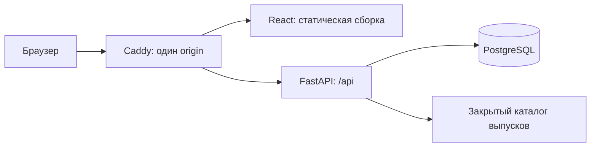

# Устройство Private Gateway Web

## Границы

Веб-приложение работает отдельно от VPN-сервера. Его данные — участники сайта, приглашения,
состояние входа, доверенные устройства и каталог выпусков. Оно не хранит VPN-профили,
адреса подписок или настройки подключений и не вызывает API рабочего Private Gateway.

Согласованный макет v8 остается в `mockup/`. Рабочая главная переносится в React с сохранением
композиции, локальных шрифтов, значков и двух языков. Встроенный клиент — отдельная явно
обозначенная демонстрация, не система VPN и не форма входа в клиент.

## Компоненты

В разработке Vite проксирует `/api` в локальный FastAPI. Cookie и CSRF остаются в одном
origin; прямой публичный порт БД не нужен. В контейнерной упаковке Caddy раздает только
сборку интерфейса и проксирует API. Файлы клиента не попадают в публичную статику.

## Доступ

Регистрация разрешена по действующему одноразовому приглашению, привязанному к email.
Участник входит по email и паролю. Двухфакторная проверка — только у администратора
(DECISIONS п. 11): после пароля требуется настройка или проверка TOTP, сеанса без нее у
администратора нет, а `/admin/*` проверяют 2FA еще раз. Резервные коды выдаются один раз.
Для доверенного браузера администратора после правильного пароля допускается пропуск TOTP на 30 дней.

Пользователь с незавершенным входом не получает доступ к кабинету. Роль и состояние участника
проверяет сервер, независимо от видимых вкладок React. Отзыв доступа прекращает действие
сеансов и доверенных устройств; скачивание также каждый раз проходит проверку доступа.

Секреты TOTP шифруются, пароли хешируются Argon2id, случайные токены и резервные коды не
хранятся открытым текстом. Лимиты и одноразовые операции используют общую PostgreSQL,
а не память одного процесса. Административные операции требуют собственного TOTP.
Смена пароля и выход на всех устройствах повышают `auth_version`: остаются только текущий
браузер и новый сеанс в нем.

Ненужные данные не хранятся: администратор удаляет участника целиком (журнал скачиваний
остается без имени), а API раз в сутки (`services/retention.py`) удаляет закончившиеся входы,
доверенные браузеры, старые приглашения и коды, записи журналов старше своих сроков.

Точные запросы, статусы и ошибки — в [api-contract.md](api-contract.md).

## Выпуски клиента

Пять платформ всегда видимы; карточка системы посетителя (по User-Agent) идет первой.
Пока администратор не добавил проверенный выпуск, версия, размер и ссылка отсутствуют. Windows, macOS, Linux и Android получают файл через закрытый
API. Для iOS допускается только внесенная проверенная ссылка App Store. Никаких
автоматически придуманных ссылок на releases или версии нет.

## Что адаптировано

AI Agent Capper предоставляет основу входа и приемы веб-архитектуры. Доменные сущности
аналитики, AI, ставок, очередей и уведомлений не входят в сайт загрузок. Его большой
прикладной слой нельзя скопировать целиком без лишних зависимостей и функций. Точный
перенос кода и отличия записаны в [sources/REUSE_REGISTER.md](sources/REUSE_REGISTER.md).

Упаковка в Docker и проверка на локальном стенде не публикуют сайт. Подключение домена,
рабочие секреты, резервное копирование и публикация — отдельный этап.
